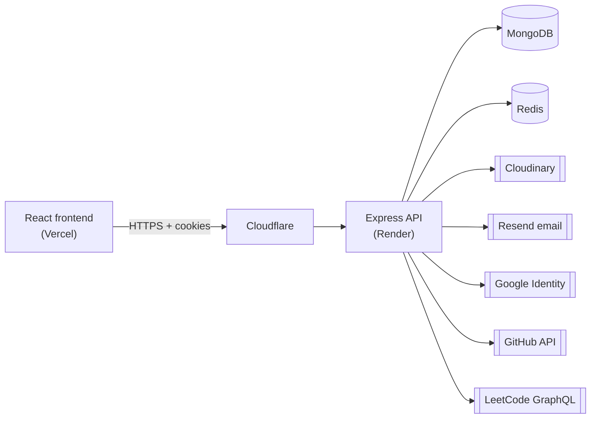

<div align="center">

# Portfolio Platform — Backend API

**A headless CMS and REST API that powers [suryanshuverma.com.np](https://suryanshuverma.com.np)**

Every piece of content on the portfolio — profile, projects, experience, skills, blog, certificates — is managed through this API and an admin dashboard, with no redeploy needed to update the site.

[](https://nodejs.org)
[](https://expressjs.com)
[](https://mongoosejs.com)
[](https://redis.io)
[](#-api-documentation)

[Live API](https://portfolio-backend-uy0a.onrender.com/api/v1/health) ·
[Interactive Docs](https://portfolio-backend-uy0a.onrender.com/api-docs) ·
[Frontend Repo](https://github.com/suryanshuverma0/React-Portfolio)

</div>

---

## Table of Contents

- [Overview](#-overview)
- [Features](#-features)
- [Tech Stack](#-tech-stack)
- [Architecture](#-architecture)
- [Getting Started](#-getting-started)
- [Environment Variables](#-environment-variables)
- [Scripts](#-scripts)
- [API Documentation](#-api-documentation)
- [Project Structure](#-project-structure)
- [Security](#-security)
- [Deployment](#-deployment)
- [Further Documentation](#-further-documentation)
- [Author](#-author)

---

## 📌 Overview

This service is the backend for a personal portfolio platform. It exposes:

- **Public, read-only endpoints** (`/public`) that the portfolio website consumes to render its content.
- **Admin-only endpoints** protected by JWT cookies and role checks, used by the dashboard to create, update and delete content.
- **Authentication** via email/password, Google Sign-In and WebAuthn **passkeys**.
- **First-party analytics**, a **moderated blog**, a **contact inbox with email replies**, and **live GitHub/LeetCode stats**.

The API is versioned under `/api/v1`, documented with a hand-written OpenAPI 3.0 spec, and served behind Cloudflare on Render.

---

## ✨ Features

| Area | What it does |
| --- | --- |
| **Content management** | Full CRUD for profile, education, experience, services, skills, projects, certificates and stats. Every resource has a public read endpoint and admin-only write endpoints. |
| **Authentication** | Email/password (bcrypt), Google Sign-In (ID-token verification), and passwordless **WebAuthn passkeys** — sign-up, login, multi-device linking by email, rename and revoke. |
| **Session handling** | Short-lived access token (15 min) + refresh token (7 days) in `httpOnly` cookies (`Secure` in production). Refresh tokens are stored server-side and compared on refresh, so logout invalidates them. |
| **Authorization** | Role-based (`admin` / `user`). Admin role is granted from an `ADMIN_EMAILS` allowlist at login, never from client input. |
| **Access control** | An admin toggle (`publicAccessEnabled`) closes registration/login to everyone except admins; `maintenanceMode` takes the public site offline. |
| **Blog** | Markdown posts with slugs, tags, reading time, cover images and visibility; public comments held for admin approval. |
| **Contact inbox** | Stores visitor messages, sends an auto-acknowledgement, and lets the admin reply in-app via [Resend](https://resend.com). |
| **Analytics** | Privacy-friendly page-view tracking (anonymous visitor ID, device, browser, OS, country via GeoIP, referrer), with overview, trends, active-now and a recent-activity feed. |
| **Integrations** | Live GitHub profile/repo stats and LeetCode solve stats, cached in Redis for one hour. |
| **Media** | Image uploads (single or up to 10 at a time, 5 MB each) streamed to Cloudinary. |
| **Rate limiting** | Redis-backed sliding-window limiter implemented as an atomic Lua script, keyed per IP and, for sensitive routes, per email. |
| **Observability** | Structured JSON logging with Pino, request logging with `pino-http`, health check endpoint. |
| **Docs** | Interactive Swagger UI at `/api-docs` and the raw spec at `/api-docs.json`. |

---

## 🛠 Tech Stack

| Layer | Technology |
| --- | --- |
| Runtime | Node.js (ES Modules) |
| Framework | Express 5 |
| Database | MongoDB with Mongoose 9 |
| Cache / rate limiting / WebAuthn challenges | Redis (`redis` v6 client) |
| Validation | Zod 4 |
| Auth | `jsonwebtoken`, `bcrypt`, `google-auth-library`, `@simplewebauthn/server` |
| Media | Cloudinary + Multer (memory storage) |
| Email | Resend |
| Security middleware | Helmet, CORS, HPP, compression, cookie-parser |
| Analytics enrichment | `ua-parser-js`, `geoip-lite` |
| Logging | Pino, `pino-http`, `pino-pretty` |
| API docs | OpenAPI 3.0 + `swagger-ui-express` |
| Tooling | Nodemon, ESLint, Prettier |

---

## 🏗 Architecture



Each feature is a self-contained **module** with the same five layers:

```
routes  →  validation (Zod)  →  controller  →  service  →  model (Mongoose)
```

- **Routes** wire up middleware: rate limiter → `protect` / `protectAdmin` → `validate(schema)` → controller.
- **Controllers** handle HTTP concerns only (status codes, cookies, response shape).
- **Services** hold business logic and are the only layer that talks to models, Redis or third-party APIs.

See [docs/ARCHITECTURE.md](docs/ARCHITECTURE.md) for the request lifecycle, data model and caching strategy.

---

## 🚀 Getting Started

### Prerequisites

- **Node.js 20+** (developed on Node 22)
- **MongoDB** — local instance or a free [MongoDB Atlas](https://www.mongodb.com/atlas) cluster
- **Redis** — local instance, Docker, or a hosted provider such as [Upstash](https://upstash.com) / Redis Cloud
- A **Cloudinary** account (image uploads)
- A **Google Cloud OAuth client ID** (Google Sign-In)
- *(Optional)* A **Resend** API key — without it, password-reset and passkey links are written to the server log instead of emailed

> **Tip:** spin up Redis locally with Docker:
> ```bash
> docker run -d --name redis -p 6379:6379 redis:7-alpine
> ```

### Installation

```bash
# 1. Clone the repository
git clone https://github.com/suryanshuverma0/portfolio-backedn.git
cd portfolio-backedn

# 2. Install dependencies
npm install

# 3. Create your environment file and fill in the values
cp .env.example .env

# 4. Start the development server (auto-reloads on change)
npm run dev
```

The API starts on `http://localhost:3000` (or whatever `PORT` you set). Verify it:

```bash
curl http://localhost:3000/api/v1/health
# {"success":true,"message":"API healthy","uptime":3.21,"timestamp":"..."}
```

Then open **http://localhost:3000/api-docs** to explore every endpoint.

### Creating the first admin

1. Add your email to `ADMIN_EMAILS` in `.env`.
2. Register through the frontend (`/register`) or `POST /api/v1/auth/register`.
3. Your account is assigned the `admin` role automatically, and the dashboard becomes available at `/dashboard`.

---

## 🔐 Environment Variables

Copy [`.env.example`](.env.example) to `.env`. The server **refuses to start** if any variable marked *required* is missing (see `src/config/env.js`).

| Variable | Required | Description |
| --- | :---: | --- |
| `PORT` | ✅ | Port the HTTP server listens on (e.g. `3000`). |
| `NODE_ENV` | | `development` or `production`. Controls stack traces in error responses and `Secure` cookies. |
| `MONGO_URI` | ✅ | MongoDB connection string. |
| `REDIS_URL` | ✅ | Redis connection string, e.g. `redis://localhost:6379` or `rediss://...` for TLS. |
| `ACCESS_TOKEN_SECRET` | ✅ | Secret for signing access-token JWTs. Use a long random string. |
| `ACCESS_TOKEN_EXPIRY` | | Access-token lifetime, e.g. `15m`. |
| `REFRESH_TOKEN_SECRET` | ✅ | Secret for signing refresh-token JWTs. Must differ from the access secret. |
| `REFRESH_TOKEN_EXPIRY` | | Refresh-token lifetime, e.g. `7d`. |
| `CLOUDINARY_CLOUD_NAME` | ✅ | Cloudinary cloud name. |
| `CLOUDINARY_API_KEY` | ✅ | Cloudinary API key. |
| `CLOUDINARY_API_SECRET` | ✅ | Cloudinary API secret. |
| `GOOGLE_CLIENT_ID` | ✅ | Google OAuth client ID used to verify Google ID tokens. Must match the frontend's `VITE_GOOGLE_CLIENT_ID`. |
| `ADMIN_EMAILS` | ✅ | Comma-separated list of emails that receive the `admin` role. |
| `FRONTEND_URL` | | Base URL of the frontend, used to build password-reset and passkey-link URLs in emails. |
| `WEBAUTHN_RP_ID` | ✅ | WebAuthn relying-party ID — the bare domain, no scheme or port (`localhost` locally, `suryanshuverma.com.np` in production). |
| `WEBAUTHN_RP_NAME` | | Display name shown in the passkey prompt. Defaults to `Portfolio CMS`. |
| `RESEND_API_KEY` | | Resend API key. If unset, emails are logged instead of sent. |
| `RESEND_FROM_EMAIL` | | Sender address, e.g. `Portfolio <noreply@yourdomain.com>`. Must be on a domain verified in Resend. |

> Generate strong secrets with:
> `node -e "console.log(require('crypto').randomBytes(64).toString('hex'))"`

---

## 📜 Scripts

| Command | Description |
| --- | --- |
| `npm run dev` | Start with Nodemon — restarts on file changes. |
| `npm start` | Start in production mode with plain Node. |

---

## 📖 API Documentation

| Resource | URL |
| --- | --- |
| Interactive Swagger UI | [`/api-docs`](https://portfolio-backend-uy0a.onrender.com/api-docs) |
| Raw OpenAPI 3.0 JSON (import into Postman/Insomnia) | [`/api-docs.json`](https://portfolio-backend-uy0a.onrender.com/api-docs.json) |
| Endpoint reference (Markdown) | [docs/API.md](docs/API.md) |

**Base URL:** `/api/v1`

All responses share one envelope:

```jsonc
// Success
{ "success": true, "message": "Projects fetched successfully", "data": { /* ... */ } }

// Error
{ "success": false, "message": "Admin access required" }

// Validation error (400)
{ "success": false, "message": "Validation failed", "errors": [ /* field-level details */ ] }
```

### Modules at a glance

| Prefix | Purpose | Public | Admin |
| --- | --- | :---: | :---: |
| `/auth` | Register, login, refresh, logout, password reset, user management | ✅ | ✅ |
| `/google-auth` | Google Sign-In | ✅ | |
| `/passkey` | WebAuthn sign-up, login, device linking, management | ✅ | 🔑 |
| `/profile` | Name, headline, bio, roles, avatar | ✅ | ✅ |
| `/education` · `/experience` · `/services` · `/skill` · `/certificates` · `/stats` | Portfolio content sections | ✅ | ✅ |
| `/projects` | Projects with slugs, galleries and tech stacks | ✅ | ✅ |
| `/blog` | Posts, tags and moderated comments | ✅ | ✅ |
| `/contact` | Contact form, inbox, replies | ✅ | ✅ |
| `/analytics` | Page-view tracking and dashboards | ✅ | ✅ |
| `/settings` | SEO, socials, resume, maintenance mode, access toggle | ✅ | ✅ |
| `/integrations` | Live GitHub & LeetCode stats | ✅ | |
| `/upload` | Image uploads to Cloudinary | | ✅ |

🔑 = any signed-in user (manages their own passkeys).

---

## 📁 Project Structure

```
portfolio-backedn/
├── server.js                    # Entry point: env validation, DB/Redis connect, graceful shutdown
├── src/
│   ├── app.js                   # Express app: security middleware, routes, error handling
│   ├── config/
│   │   ├── env.js               # Fails fast on missing required env vars
│   │   ├── db.js                # MongoDB connection
│   │   ├── redis.js             # Redis client + connect/disconnect helpers
│   │   └── cloudinary.js        # Cloudinary SDK config
│   ├── middleware/
│   │   ├── auth.middleware.js           # `protect` — verifies access-token cookie
│   │   ├── authorize.middleware.js      # `requireAdmin` — role check
│   │   ├── protectAdmin.middleware.js   # [protect, requireAdmin] combined
│   │   ├── rateLimiter.middleware.js    # Redis sliding-window limiter factory
│   │   ├── lua/slidingWindow.lua.js     # Atomic Lua script for the limiter
│   │   ├── limiters.js                  # Pre-configured auth/analytics limiters
│   │   ├── validate.middleware.js       # Zod request validation
│   │   ├── upload.middleware.js         # Multer (images only, 5 MB)
│   │   └── error.middleware.js          # 404 + centralised error handler
│   ├── modules/                 # One folder per feature (routes/controller/service/model/validation)
│   │   ├── auth/  google-auth/  passkey/
│   │   ├── profile/  education/  experience/  services/  skills/
│   │   ├── projects/  certificates/  stats/
│   │   ├── blog/  contact/  analytics/  settings/
│   │   ├── integrations/  upload/
│   ├── shared/schemas/          # Reusable Mongoose sub-schemas (e.g. image)
│   ├── utils/                   # Logger, cache helper, email, admin allowlist, etc.
│   └── docs/openapi.js          # Hand-written OpenAPI 3.0 spec
├── docs/                        # Architecture, API, security and deployment guides
└── .github/workflows/
    └── keep-alive.yml           # Pings /health every 10 min to avoid Render cold starts
```

---

## 🛡 Security

Security is a first-class concern rather than an afterthought. Highlights:

- **`httpOnly` cookies** (`SameSite=None`, `Secure` in production) — tokens are never exposed to JavaScript.
- **Refresh-token binding** — the active refresh token is stored on the user record; a mismatch is rejected, and logout clears it.
- **Hashed reset tokens** — password-reset tokens are SHA-256 hashed at rest and expire after 10 minutes.
- **Layered rate limiting** — per-IP *and* per-email limits on login, password reset and passkey sign-up stop both single-source and distributed brute force.
- **Real client IP** — limiter keys use Cloudflare's `CF-Connecting-IP`, which clients cannot spoof.
- **WebAuthn hardening** — single-use challenges in Redis with a 5-minute TTL; strict `expectedOrigin` and RP ID checks.
- **Input hygiene** — Zod validation on every write route, HPP against parameter pollution, tight body-size limits (10 KB, 2 MB for blog posts only), HTML-escaping of user input in emails.
- **Helmet** headers with a strict CSP everywhere except Swagger UI.

Full details: [docs/SECURITY.md](docs/SECURITY.md).

---

## ☁️ Deployment

The production API runs on **Render** behind **Cloudflare**, with MongoDB Atlas and a hosted Redis instance. A GitHub Actions workflow pings the health endpoint every 10 minutes so the free-tier instance doesn't sleep.

Step-by-step guide: [docs/DEPLOYMENT.md](docs/DEPLOYMENT.md).

---

## 📚 Further Documentation

| Document | Contents |
| --- | --- |
| [docs/ARCHITECTURE.md](docs/ARCHITECTURE.md) | Module pattern, request lifecycle, data model, caching, auth flows |
| [docs/API.md](docs/API.md) | Every endpoint, its access level and rate limit |
| [docs/SECURITY.md](docs/SECURITY.md) | Threat model and the controls that address it |
| [docs/DEPLOYMENT.md](docs/DEPLOYMENT.md) | Render, Atlas, Redis, Cloudflare and Resend setup |

---

## 👤 Author

**Suryanshu Verma**

- Website — [suryanshuverma.com.np](https://suryanshuverma.com.np)
- GitHub — [@suryanshuverma0](https://github.com/suryanshuverma0)

---

<div align="center">
<sub>Licensed under the ISC License.</sub>
</div>
