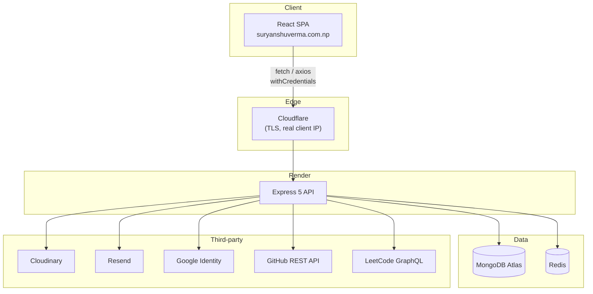
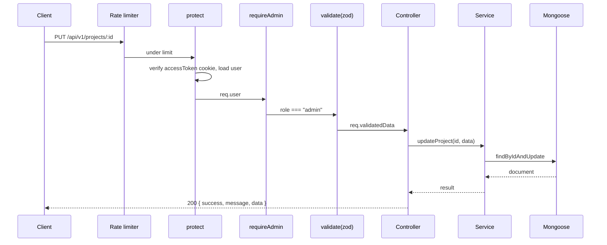
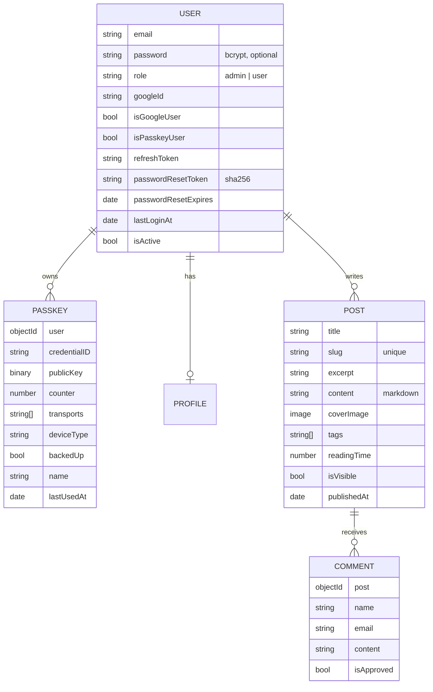
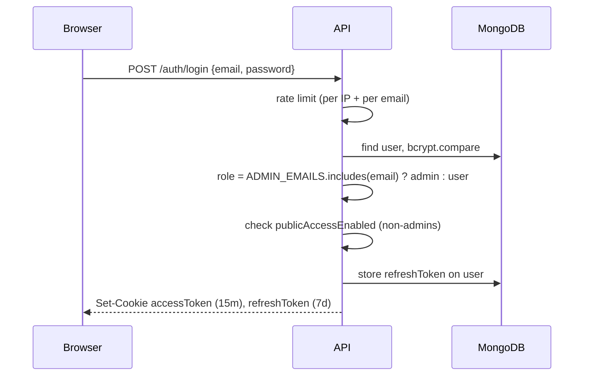

# Architecture

This document explains how the backend is organised, how a request flows through it, and the reasoning behind the main design decisions.

- [System overview](#system-overview)
- [Boot sequence](#boot-sequence)
- [Request lifecycle](#request-lifecycle)
- [Module pattern](#module-pattern)
- [Data model](#data-model)
- [Authentication flows](#authentication-flows)
- [Caching strategy](#caching-strategy)
- [Rate limiting](#rate-limiting)
- [Error handling](#error-handling)
- [Logging](#logging)

---

## System overview



| Store | Holds |
| --- | --- |
| **MongoDB** | All persistent content: users, passkeys, profile, projects, blog posts, comments, messages, page views, settings. |
| **Redis** | Ephemeral state: rate-limit windows, WebAuthn challenges, passkey-link tokens, cached analytics and integration responses. |
| **Cloudinary** | Uploaded images. MongoDB stores only `{ publicId, url }`. |

---

## Boot sequence

`server.js` runs the following in order:

1. **`validateEnv()`** — throws immediately if a required environment variable is missing, so misconfiguration fails at deploy time rather than on the first request.
2. **`connectDB()`** — connects Mongoose to `MONGO_URI`. DNS resolvers are pinned to `8.8.8.8` / `1.1.1.1` to avoid SRV-lookup failures on some hosts.
3. **`connectRedis()`** — opens the Redis connection.
4. **`http.createServer(app).listen(PORT)`** — starts accepting traffic only after both stores are ready.

**Graceful shutdown.** On `SIGTERM`, `SIGINT`, an unhandled rejection or an uncaught exception, the server stops accepting connections, waits for in-flight requests, closes MongoDB and Redis, then exits. This is what Render relies on during deploys.

---

## Request lifecycle

Global middleware in `src/app.js`, in order:

| # | Middleware | Purpose |
| --- | --- | --- |
| 1 | `trust proxy = 1` | Trust the first proxy hop so `req.ip` and `req.secure` are correct behind Render/Cloudflare. |
| 2 | `helmet` | Security headers. `crossOriginResourcePolicy` is relaxed so images can be embedded cross-origin. |
| 3 | `cors` | Allows `localhost:5173` and the production domains, with `credentials: true` for cookies. |
| 4 | `compression` | gzip responses. |
| 5 | `express.json` | **2 MB** limit for `/api/v1/blog` (Markdown posts), **10 KB** everywhere else. |
| 6 | `express.urlencoded` | 10 KB limit. |
| 7 | `cookie-parser` | Exposes `req.cookies.accessToken` / `refreshToken`. |
| 8 | `hpp` | Blocks HTTP parameter pollution. |
| 9 | `pino-http` | Structured request logs. |
| 10 | Routes | Mounted under `/api/v1/*`. |
| 11 | `notFound` → `errorHandler` | Uniform 404 and error responses. |

A typical admin write request then passes through route-level middleware:



---

## Module pattern

Every feature lives in `src/modules/<feature>/` and follows the same layout:

```
<feature>.routes.js       # URL → middleware chain → controller
<feature>.validation.js   # Zod schemas for request bodies
<feature>.controller.js   # HTTP concerns: status, cookies, response envelope
<feature>.service.js      # Business logic, DB/Redis/third-party access
<feature>.model.js        # Mongoose schema + indexes
```

**Rules of thumb**

- Controllers never touch models directly — they call services.
- Services never touch `req` / `res` — they take plain arguments and return plain data or throw.
- Modules are **self-contained**. Where a module needs a module-specific rate limiter (blog comments, contact, passkeys, Google auth, integrations), it is defined locally in that module's routes file instead of the shared `limiters.js`.

**Public / admin split.** Content modules expose:

| Route | Access | Returns |
| --- | --- | --- |
| `GET /<resource>/public` | Anyone | Only items with `isVisible: true`, sorted for display |
| `GET /<resource>` | Admin | Everything, including hidden items |
| `POST /<resource>` | Admin | Create |
| `PUT /<resource>/:id` | Admin | Update |
| `DELETE /<resource>/:id` | Admin | Delete |

Profile and Settings are **singletons** (one document each), so they use `POST /` + `PUT /` without an `:id`.

---

## Data model



Standalone collections:

| Model | Notes |
| --- | --- |
| `Profile` | Name, headline, description, availability, roles (typewriter), image. |
| `Education`, `Experience`, `Service`, `Skill`, `Certificate`, `Stat` | Ordered portfolio sections, each with `isVisible`. |
| `Project` | Slug-addressable case study: category, thumbnail, gallery and architecture images, features, technologies, challenges, learnings, evaluation metrics, GitHub/live links, `featured`, `order`. |
| `Message` | Contact-form submissions: `isRead`, `autoResponseSent`, `adminReply`, `repliedAt`. |
| `PageView` | `path`, `referrer`, `visitorId`, `device`, `browser`, `os`, `country`, timestamp. |
| `Settings` | Singleton: SEO metadata, socials, contact details, footer, resume URL, `maintenanceMode`, `publicAccessEnabled`. |

Images everywhere use the shared sub-schema in `src/shared/schemas/image.schema.js`: `{ publicId, url }`.

---

## Authentication flows

### Password login



### Token refresh

`POST /auth/refresh-token` verifies the refresh JWT **and** checks it equals the token stored on the user. Any mismatch (stolen or already-logged-out token) is rejected. On success a new access-token cookie is issued.

### Google Sign-In

The frontend obtains a Google ID token and posts it to `/google-auth/login`. The backend verifies it with `google-auth-library` against `GOOGLE_CLIENT_ID`, then finds or creates the user and issues the same cookie pair.

### Passkeys (WebAuthn)

| Flow | Endpoints | Notes |
| --- | --- | --- |
| **Sign-up** | `/passkey/signup/options` → `/signup/verify` | Creates a new account bound to its first passkey. Gated by `publicAccessEnabled` like other sign-ups. |
| **Login** | `/passkey/authentication/options` → `/authentication/verify` | Discoverable credentials — no email needed. |
| **Add passkey (signed in)** | `/passkey/registration/options` → `/registration/verify` | Requires a session. |
| **Link a new device** | `/passkey/link/request` → `/link/options` → `/link/verify` | Emails a single-use link (10-min TTL) so a device with no session can add a passkey to an existing account. |
| **Manage** | `GET /passkey`, `PATCH /passkey/:id`, `DELETE /passkey/:id` | List, rename, revoke own passkeys. |

Challenges are stored in Redis with a **5-minute TTL** and deleted after use, so each is single-use.

---

## Caching strategy

`src/utils/cache.js` provides a read-through helper:

```js
getOrSetCache(key, ttlSeconds, computeFn)
```

| Key | TTL | Why |
| --- | --- | --- |
| `analytics:overview:<days>` | 5 min | Aggregations over `PageView` are expensive. |
| `analytics:dashboard:v2` | 5 min | Dashboard KPIs. Versioned key so a shape change never serves stale data. |
| `analytics:recent-activity:<limit>` | 2 min | Activity feed. |
| `integrations:github:<username>` | 1 hour | Stays well within GitHub's unauthenticated rate limit. |
| `integrations:leetcode:<username>` | 1 hour | Avoids hammering LeetCode's GraphQL endpoint. |

Counts that must be live (unread messages, pending comments, active-now visitors) are computed outside the cached block.

---

## Rate limiting

`slidingWindowLimiter({ prefix, limit, windowInSeconds, keyBy })` stores each request as a member of a Redis sorted set scored by timestamp. A **Lua script** trims expired entries, counts, and conditionally adds the new request in **one atomic round-trip**, so concurrent requests can't race past the limit.

- Default key: `CF-Connecting-IP` header (set by Cloudflare, not spoofable by clients), falling back to `req.ip`.
- Optional `keyBy` lets a limiter key on something else — e.g. the normalised email in the request body.
- Responses include `X-RateLimit-Limit`, `X-RateLimit-Remaining` and, when blocked, `Retry-After` with a `429`.

See [API.md](API.md#rate-limits) for every limit.

---

## Error handling

All errors funnel into `errorHandler` in `src/middleware/error.middleware.js`, which normalises common cases:

| Source | Status | Message |
| --- | --- | --- |
| Mongoose `CastError` (bad ObjectId) | 400 | `Invalid resource ID` |
| Mongo duplicate key (`11000`) | 400 | `Duplicate field value` |
| `JsonWebTokenError` | 401 | `Invalid token` |
| `TokenExpiredError` | 401 | `Token expired` |
| Unknown route | 404 | `Route not found - <url>` |
| Anything else | `err.statusCode` or 500 | `err.message` |

Stack traces are included only when `NODE_ENV !== "production"`.

---

## Logging

Pino writes structured logs through the `pino-pretty` transport (colourised, human-readable). `pino-http` logs every request with method, URL, status and latency. Security-relevant events — `REGISTER_SUCCESS`, `LOGIN_SUCCESS`, etc. — are logged with the user ID and role for auditing.
